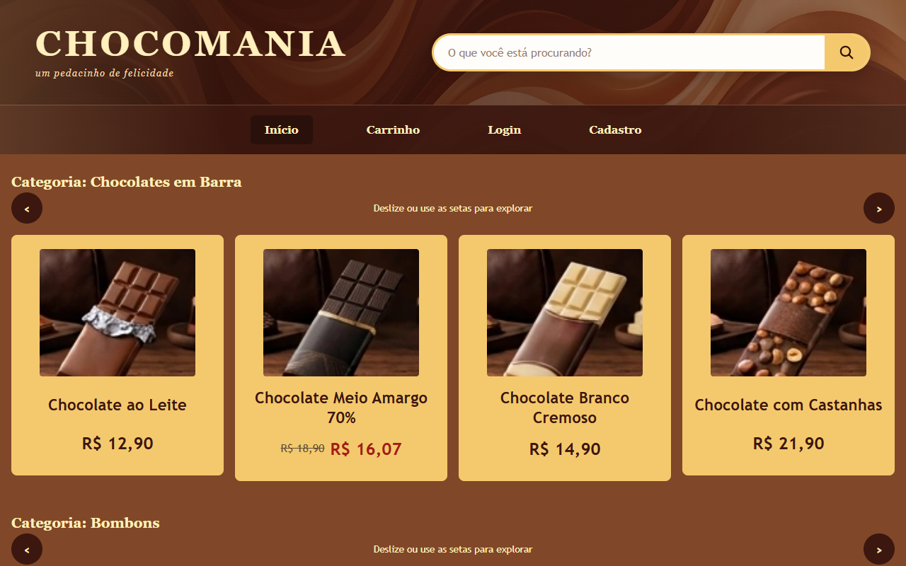
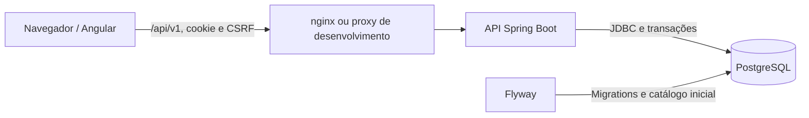
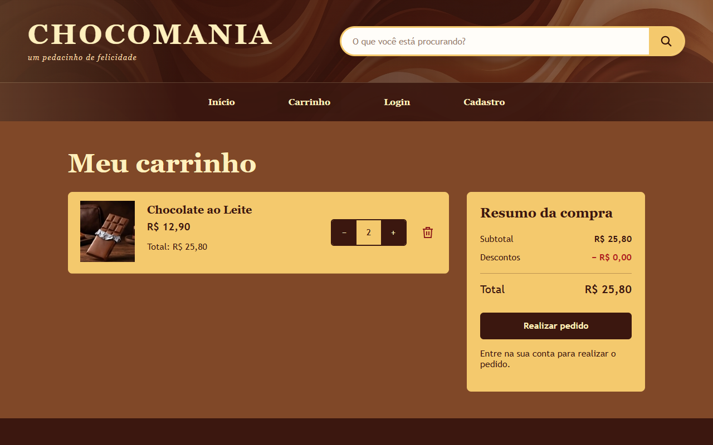

# Chocomania

E-commerce de chocolates que permite explorar produtos, gerenciar um carrinho e registrar pedidos. A aplicação integra uma loja Angular a uma API Java com PostgreSQL, cobrindo a jornada da vitrine até a confirmação do pedido, sem integração de pagamento.



## Funcionalidades

- **Catálogo e busca:** 40 produtos iniciais em quatro categorias, pesquisa por título, paginação e detalhes com preço, desconto e disponibilidade.
- **Conta do cliente:** cadastro, login, logout, edição de nome e e-mail e exclusão da própria conta com confirmação.
- **Carrinho de visitante e de conta:** ajuste de quantidades, remoção de itens e totais calculados no servidor. O carrinho autenticado permanece no banco após o logout.
- **Controle de concorrência:** alterações usam a versão do carrinho; acréscimos têm chave de idempotência para evitar duplicidade ao repetir a mesma requisição.
- **Registro de pedidos:** exige login, grava os itens com os preços vigentes e esvazia o carrinho na mesma transação. Falhas preservam o carrinho.

## Tecnologias

| Camada | Tecnologias e finalidade |
| --- | --- |
| Interface | Angular 22, TypeScript 6, RxJS, componentes standalone, signals e formulários reativos. |
| API | Java 21, Spring Boot 3.5, Spring MVC e Bean Validation para os contratos HTTP. |
| Segurança | Spring Security, sessões HTTP, CSRF e BCrypt para hashes de senha. |
| Persistência | PostgreSQL 17, Spring JDBC e Flyway para consultas, transações e migrations. |
| Execução | Docker Compose para orquestração; nginx para servir a SPA e encaminhar a API. |
| Testes | Vitest no frontend e JUnit/Mockito no backend, além de verificações HTTP em PowerShell. |

## Arquitetura e decisões técnicas



A API concentra a validação de disponibilidade e o cálculo de preços, descontos e totais em centavos inteiros. O cliente não define o valor do pedido. O pedido guarda uma cópia dos títulos e preços, preservando os valores registrados mesmo se o catálogo mudar.

`ETag` e `If-Match` detectam alterações concorrentes: uma versão antiga é rejeitada e o frontend recarrega o carrinho sem repetir automaticamente a alteração. `Idempotency-Key` impede que a repetição de um mesmo acréscimo some os itens novamente.

A autenticação usa cookie HttpOnly e proteção CSRF. As sessões expiram após 30 minutos de inatividade e ficam na memória da API: reiniciá-la exige novo login. Contas e carrinhos autenticados persistem no PostgreSQL; o vínculo do carrinho visitante depende da sessão. Ao entrar, o carrinho visitante só é transferido se a conta ainda não possui carrinho; os itens não são mesclados.

## Como executar

### Ambiente completo com Docker

Requisitos: Git e Docker com Compose v2 e suporte a `--wait`. Não é necessário instalar Node.js, Java ou Maven no host para esta opção.

```sh
git clone https://github.com/LuterLT/ecommerceChocomania.git
cd ecommerceChocomania
docker compose up --build -d --wait
```

O Compose aguarda o banco e a API ficarem saudáveis. O Flyway cria o esquema e carrega o catálogo inicial automaticamente. Não há contas de demonstração: cadastre uma pela interface.

| Serviço | Acesso padrão |
| --- | --- |
| Loja | http://127.0.0.1:5173 |
| API | http://127.0.0.1:8080/api/v1 |
| Saúde da API | http://127.0.0.1:8080/actuator/health |
| PostgreSQL | `127.0.0.1:5432` |

Para personalizar a configuração, copie [.env.example](.env.example) para `.env` antes de iniciar. No PowerShell:

```powershell
Copy-Item .env.example .env
```

`POSTGRES_DB`, `POSTGRES_USER` e `POSTGRES_PASSWORD` configuram o banco; `DB_PORT`, `API_PORT` e `FRONTEND_PORT` definem as portas locais. `CORS_ORIGINS` configura as origens aceitas com credenciais. Use `COOKIE_SECURE=true` em hospedagem com HTTPS. Os valores padrão são destinados ao desenvolvimento local e as portas são publicadas somente em `127.0.0.1`.

```sh
docker compose ps
docker compose logs -f
docker compose down
```

`down` preserva o volume `postgres_data`. A opção `down -v` remove os dados; use-a somente quando essa exclusão for intencional.

### Desenvolvimento do frontend

Use Node.js 24.15 ou superior da linha 24 e npm, compatíveis com o lockfile atual. Execute da raiz:

```sh
docker compose up --build -d --wait api
docker compose stop frontend
cd frontend
npm ci
npm run dev
```

A loja fica em http://127.0.0.1:5173 com atualização automática. O proxy em `frontend/proxy.conf.json` encaminha `/api/**` para `127.0.0.1:8080`; ajuste-o se mudar `API_PORT`. Parar o frontend Docker libera a porta 5173.

Para executar também a API fora do Docker, consulte as instruções de Java 21 e Maven no [README do backend](backend/README.md#executar).

## Como utilizar

1. Explore a vitrine ou pesquise um chocolate pelo nome.
2. Abra o produto, escolha a quantidade e adicione ao carrinho.
3. Confira os itens, descontos e total; ajuste ou remova produtos.
4. Cadastre-se ou entre na conta e clique em **Realizar pedido**. A aplicação confirma o identificador do pedido e esvazia o carrinho.

As capturas abaixo mostram o detalhe e o carrinho visitante em execução local, com duas unidades de Chocolate ao Leite e total de R$ 25,80.




## Testes e build

Frontend, dentro de `frontend/` após `npm ci`:

```sh
npm run check
npm run build
npm test
```

O build de produção é gerado em `frontend/dist/chocomania/browser`. Os testes usam Vitest e jsdom.

Backend, dentro de `backend/`, com Java 21 e Maven:

```sh
mvn verify
```

O Dockerfile da API também executa `mvn verify` durante a construção da imagem. Com os serviços ativos, execute da raiz em PowerShell 7:

```powershell
pwsh -File backend/scripts/smoke.ps1
```

O script HTTP usa o banco real e cria contas sintéticas que permanecem para inspeção. Execute-o em ambiente de desenvolvimento.

## Limitações atuais

O registro de pedidos não inclui pagamento, reserva ou baixa de estoque, frete ou entrega. Também não há painel administrativo, histórico de pedidos na interface, telefone/endereço, recuperação de senha ou envio de e-mails.

## Documentação

- [Frontend: organização, desenvolvimento e hospedagem](frontend/README.md).
- [Backend: contratos HTTP, sessão, CSRF e regras do carrinho](backend/README.md).
- [Guia resumido em PDF: arquitetura, API e acesso ao banco](output/pdf/guia-api-chocomania.pdf).
